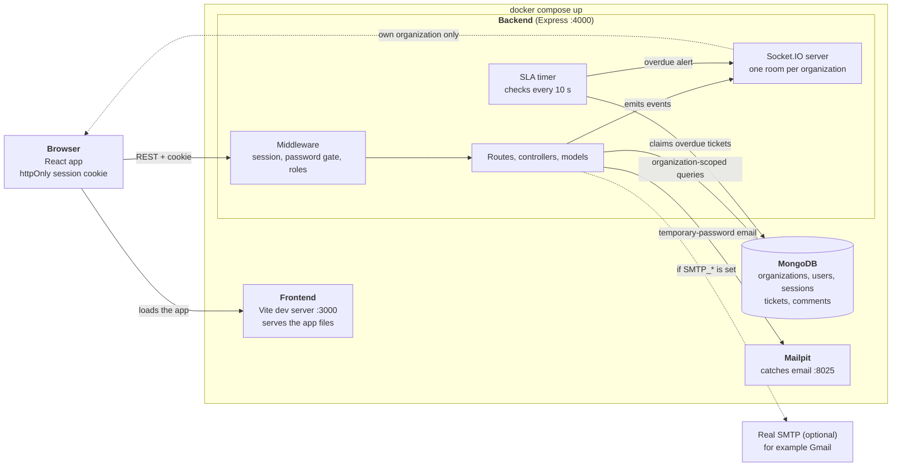

# SliqDesk

**A multi-tenant ticket management system** with role-based access, live updates and automatic SLA alerts.

Express and React, both in TypeScript, on MongoDB. The whole stack starts with one command.

**Stack:** Node.js 26 · Express · React (Vite) · TypeScript · MongoDB · Socket.IO · Docker Compose

## Highlights

- **Multi-tenant.** Every organization's data is isolated: members of one organization can never see or change another's, in the API or in real-time events.
- **Five roles, enforced on the server.** Superadmin, admin, agent, employee and viewer, with the UI reflecting what each can do.
- **Tickets with a real workflow.** Enforced status transitions, filters, pagination, comments, and closed tickets that are frozen.
- **Live updates.** Ticket and comment changes appear without a refresh, using Socket.IO rooms per organization.
- **SLA alerts.** A background check flags high and urgent tickets with no staff reply in time, and notifies the whole organization in real time. It survives an API restart.
- **Runs from a fresh clone.** Demo data for two organizations is created automatically, so you can log in straight away.

## Quick start

```bash
git clone https://github.com/DurveshMore8/sliq-desk.git
cd sliq-desk
docker compose up --build
```

When the logs show `Backend listening on port 4000`, open http://localhost:3000 and log in as `admin@acme.test` with the password `Password123!`. All demo accounts are listed in [Setup](#setup).

## Repository layout

```text
backend/              Express API, Socket.IO server, SLA check, seed data
frontend/             React app
docker-compose.yml    Starts the app, the API, MongoDB and Mailpit
```

## Contents

| Section                                         | What it covers                                                                           |
| ----------------------------------------------- | ---------------------------------------------------------------------------------------- |
| [Setup](#setup)                                 | How to run the project, seeded logins, tests and lint, triggering an SLA alert           |
| [Architecture](#architecture)                   | A diagram and the main components                                                        |
| [Key decisions](#key-decisions)                 | Tenant isolation, data model, auth, real-time, background processing, and the trade-offs |
| [API](#api)                                     | Postman collection, endpoint list and real-time events                                   |
| [Implementation status](#implementation-status) | Every requirement marked done or not done                                                |
| [Assumptions](#assumptions)                     | Decisions where the brief was unclear                                                    |
| [Next steps](#next-steps)                       | What I would improve next                                                                |
| [AI usage](#ai-usage)                           | How I used Claude, and what I rejected or corrected                                      |

## Setup

### Requirements

- Docker with Docker Compose v2 (Docker Desktop on Windows and macOS)
- Free ports **3000**, **4000** and **8025**

Nothing else needs to be installed, and no `.env` file or manual step is needed.

### Run it

From a fresh clone:

```bash
docker compose up --build
```

The first start takes a few minutes while images are built and dependencies installed. It is ready when the logs show `Backend listening on port 4000`. By then the demo data has been created automatically.

| Service | URL                          | Purpose                             |
| ------- | ---------------------------- | ----------------------------------- |
| App     | http://localhost:3000        | React frontend                      |
| API     | http://localhost:4000/health | Express backend (health check)      |
| Mailpit | http://localhost:8025        | Inbox for every email the app sends |

MongoDB runs as a fourth container and is not exposed on the host. Open the app at `localhost`, not `127.0.0.1`: the API only accepts requests from the origin in `CORS_ORIGIN`, and the session cookie is tied to the host name.

Stop with `Ctrl+C`. `docker compose down` keeps the data; `docker compose down -v` deletes it, and the next start re-creates the demo data.

### Seeded logins

On startup two demo organizations are created, each with one user per role. Every demo account uses the password **`Password123!`**. The `.test` addresses are fake and receive no email; you log in with them directly.

| Role                            | Acme Corp            | Globex Inc             |
| ------------------------------- | -------------------- | ---------------------- |
| Superadmin (organization owner) | superadmin@acme.test | superadmin@globex.test |
| Admin                           | admin@acme.test      | admin@globex.test      |
| Agent                           | agent@acme.test      | agent@globex.test      |
| Employee                        | employee@acme.test   | employee@globex.test   |
| Viewer                          | viewer@acme.test     | viewer@globex.test     |

Each organization has seven tickets covering every status. They are set up to show the rules:

| Log in as              | Try this                                                                                                                                                          |
| ---------------------- | ----------------------------------------------------------------------------------------------------------------------------------------------------------------- |
| `viewer@acme.test`     | Browse tickets and comments. There is no "New ticket" button and every control is disabled.                                                                       |
| `employee@acme.test`   | Create a ticket, then reopen "VPN access for new hire" (resolved, created by this user). Comments are allowed only on their own tickets.                          |
| `agent@acme.test`      | Claim the unassigned "Cannot reset my password". "Quarterly access review" is locked because it is assigned to the Admin.                                         |
| `admin@acme.test`      | Change any open ticket and assign it to staff. Use the Members page to add, re-role and remove members. "Update office wifi password" is closed and fully frozen. |
| `superadmin@acme.test` | Same as Admin, but the owner cannot be removed or demoted.                                                                                                        |
| `admin@globex.test`    | Only Globex's tickets and members are visible: nothing from Acme, in the UI or the API.                                                                           |

**Live updates:** open the app in two browsers (or a normal and a private window, since tabs share cookies) as two users of the same organization. Ticket changes, comments and alerts appear in both without a refresh.

**Adding members:** the Members page emails a temporary password, which the member must change at first login. Use any address, then read the message in Mailpit at http://localhost:8025.

### Triggering an SLA alert

A high or urgent ticket that gets no reply from an Admin or Agent within `SLA_MINUTES` (default **2**) is flagged overdue, and every member of the organization is notified in real time.

1. Log in as a member of one organization in two browsers, for example `agent@acme.test` and `viewer@acme.test`.
2. As the Agent, create a ticket with priority **High** or **Urgent**.
3. Don't reply as an Admin or Agent. Within about two minutes (plus up to `SLA_CHECK_INTERVAL_SECONDS`, default 10) both browsers show an **Overdue ticket** banner, and the ticket gets an **Overdue** badge in the list and on its page.
4. Post a comment as an Admin or Agent. The badge and banner disappear (the breach time stays stored). A comment from an Employee does not stop the clock.

Already in the demo data:

- **"Payment gateway returns errors"** is urgent and unanswered. Its clock starts when the demo data is created, so its alert fires about two minutes after the first start. If you log in after that, the ticket is simply already marked Overdue; the banner shows only live.
- **"Server disk almost full"** is overdue from the start.

For a faster demo, create a root `.env` file containing `SLA_MINUTES=1`, then `docker compose up`. The check runs inside the API and the deadline is stored in the database, so a restart in between doesn't lose it.

### Tests and lint

With the stack running:

```bash
docker compose exec backend npm test
docker compose exec frontend npm test
docker compose exec backend npm run lint
docker compose exec frontend npm run lint
```

Without starting the stack, prefix with `docker compose run --rm --no-deps` instead, for example `docker compose run --rm --no-deps backend npm test`.

Formatting and types, in either project: `npm run format:check` (or `npm run format` to fix) and `npm run typecheck`.

<!-- Add a short list of what the tests cover once they are written -->

### Configuration

Every setting has a working default. To override one, copy `.env.example` to `.env` in the repository root. It documents each variable, including:

- ports and URLs (change a port and its matching URL together)
- `SLA_MINUTES` and `SLA_CHECK_INTERVAL_SECONDS`
- `SEED_ON_START=false` to skip the demo data
- `SMTP_*` to send real email instead of using Mailpit
- `DOCKER_MONGO_URL` to use MongoDB Atlas instead of the bundled database

### Resetting the demo data

```bash
docker compose exec backend npm run seed:reset
```

This deletes the two demo organizations, including anything added to them, and rebuilds them. Restart the stack or refresh the browsers afterwards.

### Running without Docker

Needs Node 26 and a MongoDB (local or Atlas). Copy `backend/.env.example` to `backend/.env` and fill it in, then run `npm install` and `npm run dev` in both `backend/` and `frontend/`.

### Troubleshooting

| Symptom                                          | Cause and fix                                                                                          |
| ------------------------------------------------ | ------------------------------------------------------------------------------------------------------ |
| "Cannot reach the server", or login does nothing | Use `http://localhost:3000`, not `127.0.0.1`, and check that port 4000 is free.                        |
| A port is already in use                         | Change `FRONTEND_PORT`, `BACKEND_PORT` or `MAILPIT_UI_PORT` in `.env`, and the matching URL.           |
| Seeded login fails                               | If the logs say a demo organization was skipped because its emails exist, run the reset command above. |
| Changes to dependencies aren't picked up         | `docker compose up --build -V`                                                                         |

## Architecture



The browser loads the app from the frontend container and then talks to the API **directly**; the frontend container never calls the backend. All four containers start from the single `docker compose up`.

### Components

- **Frontend (React, TypeScript, Vite).** Pages for signup and login, the ticket list with filters and pagination, the ticket detail with comments, and the Members page for admins. Auth state lives in a React context that is initialised from `GET /auth/me`. The browser holds the httpOnly session cookie, so the app never stores a token. A single shared socket connection feeds live updates to every page.
- **Backend (Express, TypeScript).** Layered as routes, then controllers, then models. Routes map paths to controllers and attach middleware. Controllers validate input (zod) and hold the business logic. Models are Mongoose schemas. Permission rules live in two small pure modules (`permissions.ts` for members, `ticket-rules.ts` for tickets and comments), so they are in one place and easy to test.
- **MongoDB.** Five collections: `organizations`, `users`, `sessions`, `tickets` and `comments`. Everything except organizations carries an `organizationId`, and indexes lead with it.
- **Mailpit.** A local mail catcher that receives the temporary-password emails, so reviewers can read them with no setup. Real SMTP (for example Gmail) is an optional override.

### How they interact

1. **A normal request.** The browser sends the session cookie. The auth middleware looks up the session in MongoDB and loads the user. The password gate rejects users who still have a temporary password, and the role check runs next. The controller then queries MongoDB, always filtered by the `organizationId` taken from the session and never from the request. Another organization's records are reported as not found.
2. **Real-time updates.** When a ticket or comment changes, the controller emits an event to the Socket.IO room for that organization. A socket is authenticated at connection time with the same session cookie, and the _server_ places it in its organization's room, so a client cannot subscribe to another organization's events. Sockets are closed when a member is removed, has their password reset, or logs out.
3. **The SLA check.** A timer in the backend process runs every few seconds, outside any request. It looks for high or urgent tickets that are past their stored deadline and have had no staff reply, claims each one with a single atomic update so it is flagged exactly once, and emits an overdue alert to that organization's room. The deadline is stored in MongoDB, so a restart of the API does not lose it: the first check afterwards catches up.
4. **Email.** When an admin adds a member or resets a password, the backend generates a temporary password, stores only its hash, and sends it over SMTP. If sending fails, the member is still created and the admin can resend.

## Key decisions

### 1. Tenant isolation

**What**

- One shared MongoDB database. Users, tickets and comments each carry an `organizationId`; sessions reach their organization through their user.
- The organization always comes from the logged-in user's session, never from a URL, body or query parameter.
- Every read and write filters on it. Lookups by id go through shared helpers (`findTicket`, `findMember`) that include the organization, so another organization's record is reported as **not found (404)**, not forbidden, and its existence is never revealed.
- References are checked as well: an assignee must be a staff member of the same organization, and the name lookups that decorate tickets and comments are scoped to it.
- Real-time follows the same rule (see decision 5): a socket is placed in its organization's room by the server, so events never cross organizations.

**Why:** it is the simplest model that meets the requirement, and the rule is easy to find and to review: one filter on every query.

**Trade-offs and alternatives**

- Enforcement is by convention. Nothing stops a future query from forgetting the filter, unlike Postgres row-level security. The mitigations are the shared lookup helpers, scoping at the lowest level, and tests that try to read and change another organization's data. <!-- Keep this sentence only once the cross-organization tests exist. -->
- _Rejected: a database per organization._ Stronger isolation, but connection handling, indexes and migrations per tenant make it far heavier than this app needs.
- _Rejected: a global Mongoose plugin that injects the filter automatically._ Less repetition, but it hides the rule, and explicit filters are easier to reason about and test.

### 2. Data model

**What**

- Five collections: `organizations`, `users`, `sessions`, `tickets`, `comments`.
- A user belongs to exactly one organization, and holds its `organizationId` and `role` directly. Email is unique across the system.
- Tickets store status, priority, `assigneeId`, `createdById`, and three SLA fields: `slaDueAt` (the running deadline), `firstResponseAt` (first staff reply) and `overdueAt` (when the breach happened).
- Comments are their own collection, not embedded in tickets, and are append-only.
- References are ObjectIds. Names are looked up when responses are built, so a removed member shows as "Removed user" and a renamed one is always current.
- Indexes lead with `organizationId`: the ticket list indexes combine it with status, priority or assignee plus `createdAt`. Sessions have a TTL index that deletes expired ones. A partial unique index guarantees **at most one superadmin per organization**.

**Why:** comments grow without bound and are queried on their own, so embedding them would risk oversized documents and awkward updates. Looking names up at read time avoids stale copies.

**Trade-offs and alternatives**

- _Rejected: a user-organization mapping table._ It is the right design if one person can belong to several organizations, but the brief doesn't ask for that, and it would complicate login, sessions and the temporary-password flow (an invited email may already exist). A user's role is simple to read when it sits on the user. Moving to a mapping table is the migration path if multi-organization accounts are needed.
- Signup writes the organization, then the user, **without a transaction** (the bundled MongoDB is standalone, and transactions need a replica set). If the user write fails, the organization is deleted.
- Ticket updates are **conditional writes**: the filter repeats the status and assignee the rules were checked against. If someone else changed the ticket in between, the request fails with 409 instead of overwriting, which also keeps closed tickets immutable under concurrent requests.
- The ticket list uses **offset pagination** with a stable sort (`createdAt`, then `_id`). Page numbers are easy, but very deep pages get slower; cursor pagination would be the next step.
- Looking names up per response costs an extra query; storing a name snapshot would avoid it at the price of staleness.

### 3. Authentication and sessions

**What**

- **Server-side sessions** in an httpOnly, `SameSite=Lax` cookie (`Secure` in production), lasting 7 days. The cookie holds a random 256-bit token; only its **SHA-256 hash** is stored, and MongoDB's TTL index removes expired sessions.
- Passwords are hashed with Node's built-in **scrypt** (random salt, constant-time comparison). Login returns the same error for an unknown email and a wrong password, and compares against a dummy hash for unknown emails so response times match.
- **Members get an emailed temporary password** and must replace it at first login. The password is random, stored only as a hash, and never returned by the API. A guard on every feature router (rather than an allowlist) blocks everything except `/auth/me`, `/auth/logout` and `/auth/change-password` until it is changed. Changing a password ends the user's other sessions and sockets.
- The user's role is read from the database on each request, so role changes and removals take effect on the very next request.

**Why:** with sessions on the server, logout, role changes and member removal are immediate, which is hard to guarantee with stateless tokens. The cookie is invisible to page scripts, so a script injection cannot steal it. The browser's socket connection sends cookies automatically, so real-time reuses the same authentication.

**Trade-offs and alternatives**

- _Rejected: JWTs in local storage._ No database lookup per request, but revocation needs extra machinery and the token is readable by any script on the page.
- Every request costs two lookups (session, then user). That is fine at this scale and cheap to cache later.
- CSRF protection relies on `SameSite=Lax`, which blocks the cookie on cross-site POSTs; there is no CSRF token. This holds because the frontend and API are on the same site (`localhost`); a different-site deployment would need `SameSite=None; Secure` or a shared domain.
- Not implemented: rate limiting on login, email verification, and a self-service forgot-password flow. An admin's "resend password" doubles as the only reset path.
- Email is sent inside the request. A failure does not fail it: the member is still created and the response says so, so the admin can resend. A queue would be more robust.

### 4. Roles and permissions

**What**

- Five roles: **superadmin, admin, agent, employee, viewer**. The brief defines three (Admin, Agent, Viewer); the company confirmed that extra roles are fine when justified.
- **Superadmin** is the organization owner, created at signup. It cannot be removed or demoted by anyone, so every organization always has an accountable owner. Otherwise it has Admin rights.
- **Employee** can raise tickets, comment on their own tickets and reopen their own resolved ones, but cannot work tickets.
- Permissions are enforced on the server in two small **pure modules** (`permissions.ts` for members, `ticket-rules.ts` for tickets and comments), with no database access. The UI hides or disables what a role cannot do, using a client copy of the rules, but that is a convenience only.
- Rules worth knowing: nobody can change or remove themselves; an Agent can change tickets assigned to them or unassigned, may claim an unassigned ticket or release their own, but only Admins assign to others; assignees must be staff; closed tickets are fully frozen (no changes, no comments); permission is checked before ticket state, so a viewer gets 403 even on a closed ticket.

**Why the extra roles:** with only the brief's three, people who just need to report issues would have to be Agents (who can change status and priority) or Viewers (who cannot create tickets at all), which breaks least privilege. The protected owner removes the risk of an organization losing all its administrators.

**Trade-offs and alternatives**

- A bigger permission matrix means more cases to test. Keeping every rule in one place contains that.
- Roles are a constant in code, not a database table: the set is fixed, and a table would add a lookup to every request. A table would only pay off with custom roles per organization.

### 5. Real-time updates

**What**

- **Socket.IO** on the same HTTP server as the API. A socket is authenticated at connection time with the same session cookie. It is refused without a valid session, while the user still has a temporary password, or from a browser origin other than the frontend (which blocks cross-site hijacking).
- The **server** places the socket in the rooms `org:<id>`, `user:<id>` and `session:<hash>`. The server registers no client-to-server handlers, so a client cannot join or choose a room.
- Events: `ticket.created`, `ticket.updated`, `comment.created`, `sla.overdue` and `tickets.refresh`. They are emitted only to the organization's room and carry the same ticket shape as the REST responses.
- Sockets are closed when access is revoked: member removed, password reset, logout, or a password change (other sessions).
- The frontend opens **one shared socket** for the whole signed-in app. The ticket list **refetches** when something changes, so filters and pagination stay correct without duplicating the server's query logic; the detail page applies the event's ticket directly. After a reconnect, pages reload their data, so events missed while offline cannot leave a stale screen.

**Why:** rooms make the isolation rule a single line of code, and per-user and per-session rooms make "disconnect that user" trivial.

**Trade-offs and alternatives**

- _Alternative: Server-Sent Events._ Simpler, no dependency, and enough for one-way updates, but the per-organization fan-out and disconnects would be hand-written. I chose Socket.IO for the rooms.
- Rooms live in memory, so this works for **one API instance**. Several instances would need the Redis adapter.
- There is no event replay: missed events are covered by a full reload on reconnect.
- An already-open socket is not re-validated when its session expires after 7 days.
- The author's own browser also receives its events, so the UI de-duplicates comments by id.

### 6. Background processing (SLA)

**What**

- A timer inside the API process runs every `SLA_CHECK_INTERVAL_SECONDS` (default 10), outside any request. The limit is `SLA_MINUTES` (default 2), so reviewers see an alert within minutes.
- The deadline is **stored on the ticket in MongoDB**. A single pure function (`nextSlaDueAt`) decides after every create or update whether a clock runs: priority high or urgent, status open or in progress, no staff reply yet, not already flagged. This handles raising or lowering priority, resolving, closing and reopening consistently, and an unrelated edit never extends an existing deadline.
- Each overdue ticket is **claimed with one atomic conditional update**, so it is flagged exactly once even across ticks or API instances, and a staff reply that lands first wins. Then `ticket.updated` and `sla.overdue` go to that organization's room.
- Only replies from superadmin, admin or agent stop the clock; an employee's reply does not.
- "Overdue" is computed on the server (`overdue` in the ticket JSON): breached, unanswered and still open. The breach time is kept for reporting even after the badge disappears.

**Why:** persisting the deadline means a restart of the API does not lose it: the first check afterwards flags anything that came due while the API was down, and only the alert is late. It needs no extra infrastructure.

**Trade-offs and alternatives**

- _Rejected: a `setTimeout` per ticket._ Lost on restart.
- _Alternative: BullMQ with delayed jobs on Redis._ Exact timing and a separate worker, but another service to run, and priority changes and a Redis data loss would have to be reconciled with the database anyway. Redis was optional in the brief.
- Polling means an alert can be up to one interval late, and the check shares a process with request handling. At much higher load it should move to a separate worker.

### 7. Other decisions

- **TypeScript on both sides; Node 26 (LTS).** TypeScript is pinned to 6.0 because `typescript-eslint` does not support 7 yet; the pin can be lifted once it does.
- **One repository, one command.** Compose runs the development servers with hot reload and bind mounts, which is quick for reviewers but not a production deployment. Local MongoDB and Mailpit are the defaults, with optional overrides (Atlas, real SMTP), so a fresh clone needs no external account or secret. Compose sets every backend variable explicitly so a local `backend/.env` cannot leak into the containers.
- **Seed data on startup, idempotent**, so a fresh start is immediately usable. It is built to show the rules, not just to fill tables.
- **API conventions.** Every response uses one envelope (`success`, `message`, `data`) so the frontend has one parsing path. Errors are thrown as typed errors and converted in one central handler. Input is validated with zod. The backend is layered routes, controllers, models.
- **Frontend.** React Router and plain CSS, with no UI library. Filters and the page number live in the URL, so views survive a refresh. Responses from outdated requests are ignored. Destructive actions ask for confirmation, and route guards mirror the server rules without replacing them.
- **Tooling.** Vitest for tests in both projects, ESLint and Prettier everywhere.

## API

The API runs at `http://localhost:4000`. The quickest way to explore it is the **Postman collection**; the full endpoint list is below.

### Postman collection

Import `postman/SliqDesk.postman_collection.json` into Postman (Import, then select the file). It contains a request for every endpoint, with a description of who may call it.

1. Open **Auth → Log in (seeded users)** and send one request, for example "Log in as Acme admin". Postman stores the session cookie, so the rest of the collection runs as that user. Send a different login request to switch user.
2. Use the other folders. Requests save the ids the next ones need (`ticketId`, `memberId`, ...) as collection variables.
3. Two folders contain automated tests. Right-click a folder and choose **Run folder** to execute them; every test should pass:
   - **Permission checks**: the server refuses actions a role may not perform (for example a viewer creating a ticket).
   - **Isolation check**: a member of one organization cannot read or change another organization's tickets or comments (every cross-organization request returns 404).

The `baseUrl` collection variable defaults to `http://localhost:4000`.

### Conventions

**Response envelope.** Every response, including errors, has the same shape; `data` is always an object (`{}` when empty):

```json
{
  "success": true,
  "message": "Ticket created",
  "data": { "ticket": { "...": "..." } }
}
```

**Validation errors** return status 400 with the details in `data.errors`:

```json
{
  "success": false,
  "message": "Validation failed",
  "data": {
    "errors": [{ "path": "email", "message": "Invalid email address" }]
  }
}
```

**Authentication** uses a session cookie (`sid`, httpOnly) set by signup and login. Browsers and Postman send it automatically; there are no tokens in request or response bodies.

**Status codes**

| Code     | Meaning                                                                                                                       |
| -------- | ----------------------------------------------------------------------------------------------------------------------------- |
| 200, 201 | Success, created                                                                                                              |
| 400      | Validation failed, malformed JSON, or an invalid value (wrong current password, assignee who is not staff)                    |
| 401      | Not logged in, or wrong email or password                                                                                     |
| 403      | Role not allowed. Also returned with `data.code = "PASSWORD_CHANGE_REQUIRED"` while a temporary password has not been changed |
| 404      | Not found. This includes records of **other organizations**, which are never revealed                                         |
| 409      | Conflict: email already registered, closed ticket, invalid status transition, or the ticket was changed concurrently          |
| 500      | Unexpected server error                                                                                                       |

Ids are MongoDB ObjectIds (strings) and dates are ISO 8601.

### Endpoints

**Health and auth**

| Method | Path                    | Who       | Description                                                                                                                         |
| ------ | ----------------------- | --------- | ----------------------------------------------------------------------------------------------------------------------------------- |
| GET    | `/health`               | Public    | API and database status                                                                                                             |
| POST   | `/auth/signup`          | Public    | Creates an organization and its superadmin, then logs in. Body: `name`, `email`, `organizationName`, `password` (min. 8 characters) |
| POST   | `/auth/login`           | Public    | Body: `email`, `password`. Sets the session cookie                                                                                  |
| POST   | `/auth/logout`          | Anyone    | Ends the session and clears the cookie                                                                                              |
| GET    | `/auth/me`              | Logged in | Current user, role and organization                                                                                                 |
| POST   | `/auth/change-password` | Logged in | Body: `currentPassword`, `newPassword`. Ends the user's other sessions                                                              |

**Members** (superadmin and admin only)

| Method | Path                           | Description                                                                                                                                                                  |
| ------ | ------------------------------ | ---------------------------------------------------------------------------------------------------------------------------------------------------------------------------- |
| GET    | `/members`                     | List the organization's members                                                                                                                                              |
| POST   | `/members`                     | Add a member. Body: `name`, `email`, `role` (`admin`, `agent`, `employee` or `viewer`). A temporary password is emailed; the response never contains it. Returns `emailSent` |
| PATCH  | `/members/:id/role`            | Body: `role`. Not allowed on yourself or on the owner                                                                                                                        |
| DELETE | `/members/:id`                 | Remove a member, end their sessions and unassign their open tickets. Not allowed on yourself or on the owner                                                                 |
| POST   | `/members/:id/resend-password` | Issue and email a new temporary password; the member is signed out everywhere                                                                                                |

**Tickets**

| Method | Path                    | Who                                   | Description                                                                                                                                                                                                                    |
| ------ | ----------------------- | ------------------------------------- | ------------------------------------------------------------------------------------------------------------------------------------------------------------------------------------------------------------------------------ |
| GET    | `/tickets`              | All roles                             | List, newest first. Query: `status`, `priority`, `assigneeId` (a user id, `me` or `unassigned`), `page` (default 1), `limit` (default 10, max 50). Returns `tickets` and `pagination` (`page`, `limit`, `total`, `totalPages`) |
| GET    | `/tickets/assignees`    | All roles                             | Staff members who can be assigned tickets                                                                                                                                                                                      |
| POST   | `/tickets`              | Not viewers                           | Body: `title` (max 200), `description` (max 5000), optional `priority` (`low`, `medium`, `high`, `urgent`; default `medium`)                                                                                                   |
| GET    | `/tickets/:id`          | All roles                             | One ticket                                                                                                                                                                                                                     |
| PATCH  | `/tickets/:id`          | Role rules apply                      | Body: any of `status`, `priority`, `assigneeId` (a staff user id or `null`)                                                                                                                                                    |
| GET    | `/tickets/:id/comments` | All roles                             | The ticket's comments, oldest first (up to 500)                                                                                                                                                                                |
| POST   | `/tickets/:id/comments` | Staff; employees on their own tickets | Body: `body` (max 2000). Not on closed tickets                                                                                                                                                                                 |

Status transitions: `open` → `in_progress`, `resolved`, `closed`; `in_progress` → `open`, `resolved`; `resolved` → `open`, `in_progress`, `closed`; `closed` is final. See _Key decisions_ for who may do what.

**Ticket object:** `id`, `title`, `description`, `status`, `priority`, `assignee` (`{ id, name }` or `null`), `createdBy` (`{ id, name }`), `overdue`, `firstResponseAt`, `slaDueAt`, `overdueAt`, `createdAt`, `updatedAt`. `overdue` is true while the ticket has breached its SLA, is unanswered and is still open; `overdueAt` keeps the breach time.

**Comment object:** `id`, `ticketId`, `body`, `author` (`{ id, name, role }`; a removed author shows as "Removed user" with a `null` role), `createdAt`.

### Real-time events (Socket.IO)

Connect to the API's origin with the session cookie. The server decides which organization's events you receive; clients cannot choose a room.

| Event             | Payload       | When                                                                                                |
| ----------------- | ------------- | --------------------------------------------------------------------------------------------------- |
| `ticket.created`  | `{ ticket }`  | A ticket is created in your organization                                                            |
| `ticket.updated`  | `{ ticket }`  | A ticket's status, priority, assignee or SLA state changes                                          |
| `comment.created` | `{ comment }` | A comment is added to a ticket                                                                      |
| `sla.overdue`     | `{ ticket }`  | A high or urgent ticket got no staff reply within the SLA time (a `ticket.updated` is sent as well) |
| `tickets.refresh` | `{}`          | A bulk change happened, such as a removed member's tickets being unassigned; refetch                |

To watch events from a terminal, with the stack running:

```bash
docker compose exec backend node scripts/listen.js admin@acme.test Password123!
```

It logs in, opens a socket and prints every event it receives. Run it for users of two organizations to see that events never cross.

## Implementation status

### Accounts and organizations

| Requirement                                                        | Status | Notes                                                                                                 |
| ------------------------------------------------------------------ | ------ | ----------------------------------------------------------------------------------------------------- |
| Signing up creates an organization, with the new user as its Admin | Done   | The creator becomes the **superadmin**: an Admin who cannot be removed or demoted (see Key decisions) |
| Users can log in and log out                                       | Done   | Server-side sessions in an httpOnly cookie                                                            |
| Admin can add members with a role                                  | Done   | The member receives an emailed temporary password and must change it at first login                   |
| Admin can change a member's role                                   | Done   | Takes effect on the member's next request                                                             |
| Admin can remove a member                                          | Done   | Their sessions and sockets are closed and their open tickets are unassigned                           |

### Roles and permissions

| Requirement                                                                                  | Status | Notes                                                                                                                                                                                      |
| -------------------------------------------------------------------------------------------- | ------ | ------------------------------------------------------------------------------------------------------------------------------------------------------------------------------------------ |
| Permissions enforced on the server                                                           | Done   | Rules live in `permissions.ts` and `ticket-rules.ts`; the UI only mirrors them                                                                                                             |
| A member of one organization never sees or changes another's data                            | Done   | Every query is scoped by the organization from the session; other organizations' records return 404; real-time events are scoped by room. Postman folder "Isolation check" demonstrates it |
| View tickets and comments: all roles                                                         | Done   |                                                                                                                                                                                            |
| Create tickets and add comments: Admin and Agent, not Viewer                                 | Done   | Employees (an extra role) can create tickets and comment on their own                                                                                                                      |
| Update status, priority, assignee: Admin any ticket, Agent assigned or unassigned, Viewer no | Done   | An Agent may assign an unassigned ticket only to themselves (see Assumptions)                                                                                                              |
| Manage members: Admin only                                                                   | Done   | Superadmin and admin                                                                                                                                                                       |

### Tickets and comments

| Requirement                                                       | Status | Notes                                                                                    |
| ----------------------------------------------------------------- | ------ | ---------------------------------------------------------------------------------------- |
| Create, list, view and update tickets                             | Done   |                                                                                          |
| Four statuses, enforced transitions, closed tickets cannot change | Done   | Conditional writes keep closed tickets immutable even under concurrent requests          |
| List filtered by status, priority and assignee, and paginated     | Done   | `assigneeId` also accepts `me` and `unassigned`; filters and page number live in the URL |
| Members can add comments                                          | Done   | Viewers cannot; employees only on their own tickets; closed tickets accept none          |

### Real-time updates

| Requirement                                               | Status | Notes                                                                                                                                  |
| --------------------------------------------------------- | ------ | -------------------------------------------------------------------------------------------------------------------------------------- |
| Members see ticket and comment changes without refreshing | Done   | Socket.IO. After a reconnect the pages reload, so missed events cannot leave a stale view. The Members page is not live (not required) |
| A user only receives events for their own organization    | Done   | Rooms are assigned by the server from the session; the client cannot choose one                                                        |

### Background processing

| Requirement                                                                                                                              | Status | Notes                                                                                                                                                                                                        |
| ---------------------------------------------------------------------------------------------------------------------------------------- | ------ | ------------------------------------------------------------------------------------------------------------------------------------------------------------------------------------------------------------ |
| High or urgent ticket with no Admin or Agent comment within a set time is flagged overdue, and the organization is notified in real time | Done   | Overdue badge plus an alert banner                                                                                                                                                                           |
| The time limit is configurable                                                                                                           | Done   | `SLA_MINUTES` (default 2); the check runs every `SLA_CHECK_INTERVAL_SECONDS` (default 10)                                                                                                                    |
| The check runs outside the request and survives an API restart                                                                           | Done   | A timer in the API process, with the deadline stored in MongoDB, so the first check after a restart catches up. A banner only reaches browsers connected at that moment; the Overdue badge is always correct |

### Frontend

| Requirement                      | Status | Notes                                               |
| -------------------------------- | ------ | --------------------------------------------------- |
| Sign up and log in               | Done   |                                                     |
| Ticket list with filters         | Done   | With pagination                                     |
| Ticket detail page with comments | Done   |                                                     |
| Members page for Admins          | Done   | Hidden from other roles; the server enforces it too |
| Live updates                     | Done   | Ticket list and detail, comments and SLA alerts     |
| Controls reflect the user's role | Done   | Unavailable actions are hidden or disabled          |

### Not fully done

#### Automated tests

- **What exists:** the backend has three small test files (the health endpoint, password hashing and session tokens). The frontend has none.
- **What is missing:** tests for the critical paths: the ticket permission matrix and status transitions, the member-management rules, the SLA deadline logic and flagging a ticket exactly once, tenant isolation, and the temporary-password gate.
- **Why:** I am still learning how to write automated tests, so I spent my time building every feature and checking each one by hand: demo data for every role, and a Postman collection with assertions for the permission and isolation rules. That is a weaker safety net than automated tests, and I would rather say so plainly.
- **How I would finish it:**
  1. **Unit tests for the pure rule modules first**, since they need no database: the permission matrix and transitions in `ticket-rules.ts` (including that closed tickets are frozen and that a viewer gets 403 before a closed-ticket 409), `canManage` in `permissions.ts`, and `nextSlaDueAt` and `isOverdue` in `sla.ts`. They were written as plain functions so that they can be tested directly.
  2. **Integration tests against an in-memory MongoDB** (`mongodb-memory-server` with `supertest`) for tenant isolation across two organizations, session and password-gate behaviour, and the atomic claim that flags an overdue ticket once.
  3. **Frontend component tests** (React Testing Library) for role-aware controls.

### Beyond the brief

- Two extra roles (superadmin and employee), justified in _Key decisions_.
- An emailed temporary password with a forced change at first login, and an admin "resend" action.
- A Postman collection with assertions, and an idempotent demo seed with a reset command.

## Assumptions

Where the brief was unclear I made the decisions below. The company confirmed that the choice of roles was mine to make as long as I justify it (see _Key decisions_). The other points are my own judgement, so please flag any you would have decided differently.

### Accounts and sign-in

- **Email and password login.** SSO is not implemented: members are added by an Admin, so there is no company domain to bind to, and a member may use any email address.
- **The first user becomes the superadmin.** The user who signs up is an Admin who cannot be removed or demoted, so an organization always has an owner.
- **One organization per user.** Email addresses are unique across the whole system and case-insensitive (stored in lowercase).
- **Basic password and session rules.** Passwords need at least 8 characters, with no other complexity rules. Sessions last 7 days. Signing up logs the user in at once, and email verification is not implemented.
- **Emailed temporary password for new members.** A new member must change it at first login. Temporary passwords do not expire. If the email fails, the member is still created and the Admin can resend. "Resend" doubles as the only password reset, since there is no self-service forgot-password flow.
- **Removing a member deletes the account.** The email can be used again. Their open tickets become unassigned, and their tickets and comments keep their text and show the author as "Removed user".
- **Limits on member management.** Nobody can change their own role or remove themselves, nobody can modify the owner, and Admins can manage other Admins.
- **Member list visibility.** Only superadmin and admin can see the member list. Other roles see only the staff list used when assigning tickets.

### Roles and permissions

- **"Admin" covers two roles.** "Admin" in the brief means both **superadmin** and **admin**. "Agent" and "Viewer" are as in the brief. **Employee** is an extra role, justified in _Key decisions_.
- **Everyone sees all tickets in their organization.** Every role can view all tickets and comments of its own organization, employees included.
- **Agents work unassigned or their own tickets.** An Agent can update a ticket that is assigned to them or unassigned. They can assign an unassigned ticket to themselves or release their own, but only Admins assign tickets to other people. Assignees must be staff (superadmin, admin or agent) of the same organization.
- **Agents can comment on any open ticket.** This includes tickets assigned to someone else.
- **Employees raise and follow up on tickets.** An Employee can create tickets, comment on their own tickets, and reopen their own resolved tickets (back to open). They cannot change priority or assignee.
- **The creator chooses the priority.** Anyone who can create a ticket can pick any priority, including high and urgent.
- **Viewers are read-only.**

### Tickets and comments

- **Title and description are fixed.** They are set at creation (title up to 200 characters, description up to 5000) and don't change. Only status, priority and assignee can be updated.
- **New tickets start open.** Priority is medium unless chosen, and the ticket is unassigned.
- **Allowed status transitions.** open → in_progress, resolved or closed; in_progress → open or resolved; resolved → open, in_progress or closed; closed is final.
- **Only staff can close a ticket.** Employees can only reopen.
- **A closed ticket is completely frozen.** There are no changes and no new comments.
- **List behaviour.** Lists are newest first, 10 per page by default (maximum 50). Filters combine, and the assignee filter also accepts "me" and "unassigned".
- **Comments are plain, permanent text.** Up to 2000 characters, and they cannot be edited or deleted. A ticket shows up to 500 comments, oldest first.

### Real-time

- **What updates live.** The ticket list, ticket detail, comments and SLA alerts. The Members page does not, because the brief doesn't ask for it.
- **Missed events are not replayed.** Instead, pages reload their data when the connection returns.
- **Open sockets are not re-validated.** A socket stays connected until it closes, even if its session would have expired by then.

### SLA

- **One time limit for high and urgent tickets.** `SLA_MINUTES`, default **2** so reviewers see an alert quickly. The check runs every 10 seconds, so an alert can be up to about 10 seconds late.
- **When the clock starts and stops.** It starts when a ticket is created as high or urgent, or when an unanswered ticket is raised to high or urgent. It stops when the priority is lowered, the ticket is resolved or closed, or staff reply. A ticket that already had a staff reply never starts a clock.
- **Reopening restarts an unflagged clock.** Reopening an unanswered ticket restarts the clock if it hasn't been flagged yet. A ticket that was already flagged shows as overdue again when reopened.
- **Only staff replies count.** A comment from a superadmin, admin or agent stops the clock. An employee's comment does not.
- **A ticket is flagged once.** The Overdue badge disappears after a staff reply, or when the ticket is resolved or closed, but the breach time stays stored.
- **Everyone connected is alerted.** The alert reaches every member of the organization who is connected at that moment, viewers included.

### Environment

- **Development servers in Docker.** Docker Compose runs them with hot reload. It is not a production deployment.
- **A single API instance.** See _Next steps_ for what changes beyond that.
- **Open the app at `localhost`.** Use `http://localhost:3000`, not `127.0.0.1`.
- **Local MongoDB and Mailpit by default.** MongoDB has no authentication and is not exposed to the host. Atlas and real SMTP are optional overrides.
- **Demo accounts and data.** Demo accounts share one documented password and are not forced to change it. Demo data is created on startup and only exists for review.
- **Local time zone.** Dates are shown in the browser's local time zone.

## Next steps

- **A more dynamic, animated UI.** Smooth transitions between states, skeleton loaders instead of "Loading...", toasts for feedback, and a subtle highlight when a live update arrives. Animations would be switched off for users who prefer reduced motion.
- **SSO login.** Sign-in with an identity provider (Google, Microsoft or Okta) over OpenID Connect. An organization would be tied to its email domain, and people from that domain would be created on their first login with a default role. Password login would stay as a fallback.
- **Redis for caching.** Cache the session and user lookup that every request makes, and the user names added to ticket responses. The cache would be cleared at once on logout, role change or member removal, so revocation stays immediate. The same Redis would also let real-time events work across several API instances.
- **Cursor pagination with infinite scroll.** Replace page numbers with a cursor based on `(createdAt, _id)`, which matches the current sort and indexes. It stays stable while new tickets arrive and doesn't slow down on deep pages. Comments would be paginated the same way.
- **Rate limiting.** Limit login, signup, resend-password and ticket creation per IP address and per account, with a longer wait after repeated failures. Counters would live in Redis so the limits hold across several API instances. Today password guessing isn't slowed down.
- **Encryption of data in transit.** Serve everything over HTTPS (TLS), with HSTS so browsers never fall back to HTTP. The session cookie already becomes `Secure` in production. I would not add a second layer that encrypts request and response bodies inside the app, because the key would have to live in the browser, where any script on the page could read it. TLS already protects the traffic.
- **Audit log of user actions.** An append-only record of who did what, to which record, when and from where: logins and failures, member changes, password resets, ticket changes and comments. Each entry belongs to one organization, and the superadmin can browse and filter it. Old entries would need a retention policy.
- **Content Security Policy.** Allow scripts and connections only from our own frontend and API, together with related headers such as HSTS, `X-Content-Type-Options` and `frame-ancestors`, set through Helmet and the web server. It would apply to the production build, because the Vite development server needs inline scripts for hot reload.
- **Soft delete.** An `isDeleted` flag (plus a `deletedAt` timestamp, so we know when) on members and tickets instead of removing them. History stays intact, comments keep their real author name instead of "Removed user", and deletions can be undone and audited. Every query would have to exclude deleted records, which I would centralise like the organization filter.
- **Per-organization encryption keys.** Each organization gets its own key, itself protected by a master key in a key management service, and its sensitive data (ticket descriptions and comments) is encrypted with it before it reaches MongoDB. A leak exposes less, keys can be rotated, and an organization that leaves can be erased by destroying its key. The catch is that the database can't search or sort encrypted fields, so fields used for filtering would stay readable, and key management adds real complexity.

## AI usage

### Tools

- **Claude** (Anthropic), in the claude.ai chat interface. No other AI tools were used.

### How I used it

I started a chat, gave Claude the full requirements, and we worked through the project together. We began with an **action plan** (project setup, authentication, members, tickets, comments, real-time updates, the SLA check, seed data, Docker, README), then took **one feature at a time**. For each one we first discussed the design and its trade-offs, then Claude drafted the code, and I ran it and checked that it worked before moving to the next. The README was written the same way, one section at a time, with Claude drafting and me reviewing each section against what the project actually does.

I used Claude for:

- planning the architecture and the order of work
- drafting backend, frontend and Docker code
- explaining errors I hit and suggesting fixes
- drafting the README and a list of clarifying questions for the company

The decisions were mine: for example the choice of MongoDB, running locally before Docker, and the final role model.

### Suggestions I rejected or corrected

**1. Building ahead of the plan (corrected).** I had asked for the project setup first. After the Docker and tooling steps, Claude went on to write the database models, password hashing and seed data in one go. I stopped it: I wanted the setup finished, and the rest planned and built feature by feature, with a discussion before each one. Claude removed the extra files and finished only the MongoDB connection, and from then on every feature began with an agreed design. That change in process is why the data model, the roles and the member flow were each settled before any code was written.

**2. Fewer roles (rejected).** The brief defines three roles (Admin, Agent, Viewer). Claude recommended keeping those three and protecting the first user with an owner flag, because a reviewer will check behaviour against the brief's permission table. I wanted five roles: a **superadmin** (the organization owner, who cannot be removed) and an **employee** (who can raise tickets but not work them). I asked the company, and they confirmed it was my decision as long as I justified it. I kept the five roles, and the reasons are in _Key decisions_. I also changed Claude's first draft so that any Admin, not only the superadmin, can add other Admins, which matches the brief. The cost of my choice is a larger permission matrix and more tests, which I contained by keeping all the rules in two small modules.
